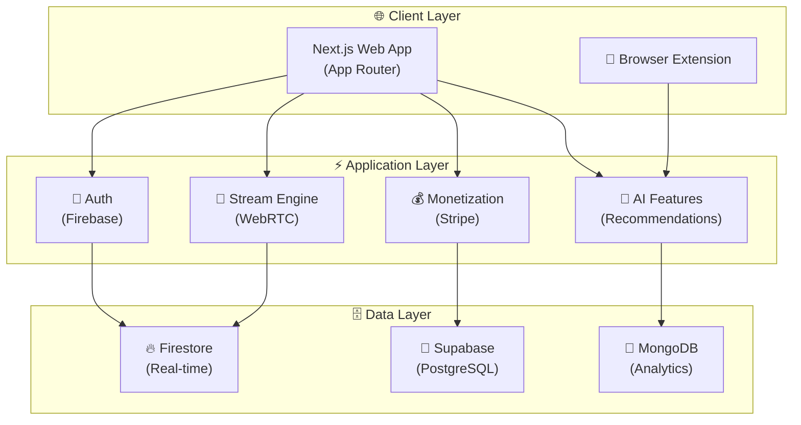
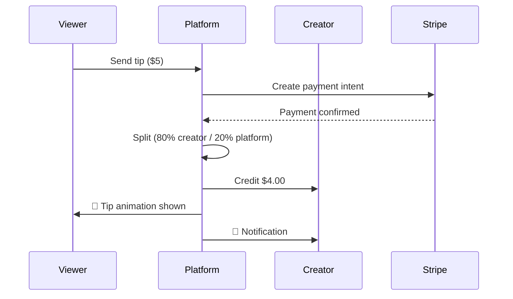

<div align="center">

# 🎮 StreamEarn

**Next-Gen Interactive Live Streaming & Monetization Platform**

[](https://github.com/harinish45/StreamEarn-8/actions/workflows/ci.yml)
[](LICENSE)
[](https://nextjs.org)
[](https://typescriptlang.org)
[](https://firebase.google.com)

> *Unified personal command centre for AI tools, live streaming, earning opportunities, and skill building*

[📋 TODO](TODO.md) · [📄 PRD](PRD.md) · [🔗 MERGE_SCOPE](MERGE_SCOPE.md)

</div>

---

## 🏗️ Platform Architecture



---

## 💰 Monetization Flow



---

## 🚀 Quick Start

```bash
git clone https://github.com/harinish45/StreamEarn-8.git
cd StreamEarn-8
npm install
npm run dev    # → http://localhost:3000
```

---

## 📁 Structure

```
StreamEarn-8/
├── 🌐  src/
│   ├── app/           # Next.js App Router
│   ├── components/    # UI components
│   └── lib/           # Business logic
├── 🔌  extension/     # Browser extension
├── 🐘  supabase/      # DB migrations
└── 📊  docs/          # Documentation
```

---

<div align="center">
<a href="LICENSE">MIT License</a> · Built by harinish45
</div>